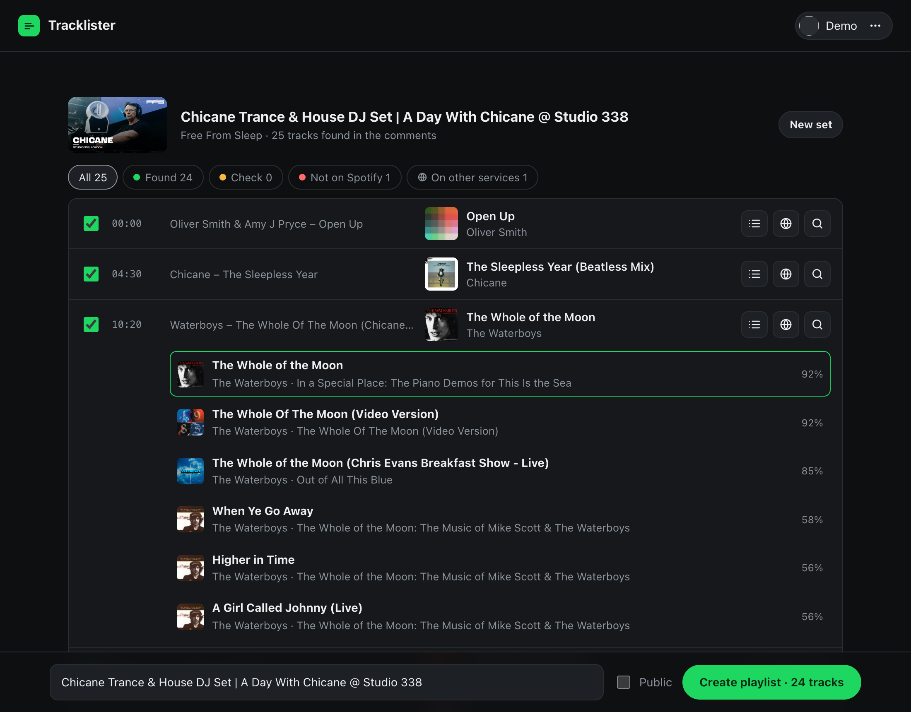
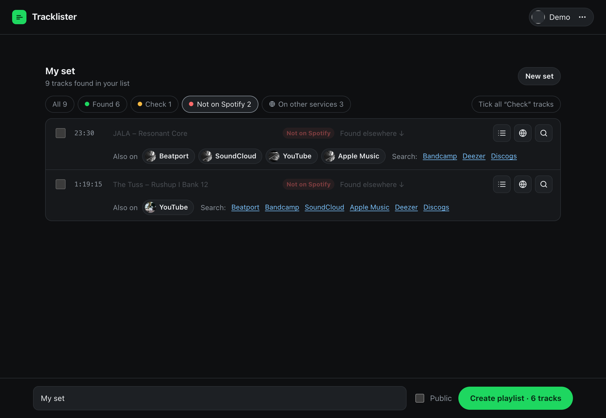
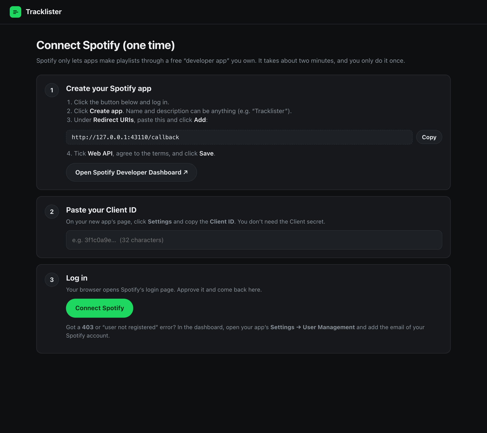

<p align="center">
  
</p>

<h1 align="center">Tracklister</h1>

<p align="center">
  <b>Turn any DJ set into a Spotify playlist.</b><br>
  Paste a YouTube, SoundCloud or Mixcloud link → Tracklister finds the tracklist, matches every song on Spotify, and builds the playlist.
</p>

<p align="center">
  <a href="https://github.com/ssdvtechno/tracklister/releases/latest"></a>
  <a href="https://github.com/ssdvtechno/tracklister/actions/workflows/build.yml"></a>
  
  <a href="LICENSE"></a>
</p>

<p align="center">
  
</p>

## Features

- **Desktop app, no terminal.** Double-click and go. No `.env` files, API keys or Python setup.
- **Finds the tracklist for you.** Looks in the video description, then the chapters, then the top comments (where tracklists are often pinned). You can also paste a list or drop a `.txt` file.
- **Cleans up messy tracklists.** Handles timestamps (`1:02:03`, `[01:23]`, trailing times), numbering, emoji, URLs, @handles, record labels (`[Ninja Tune]`, `(ARMADA)`), promo text (`FREE DOWNLOAD`) and `ID – ID` lines. Remix credits are kept.
- **Splits combined lines.** `Dynamic Forces – Ander mixed with Lars Huismann – Grid` becomes two tracks, while titles like `Dancing with Myself` stay whole. Comments such as *"sounds like an unreleased Dax track"* are skipped.
- **Smart Spotify matching.** Several searches per track, scored on title and artist similarity, preferring the right remix or original. Title-only lines are searched with the DJ's name.
- **Looks beyond Spotify.** Tracks Spotify can't find are searched on **Beatport, Bandcamp, SoundCloud, YouTube, Apple Music and Deezer**, with one-click links to wherever they turn up.
- **Recovers missed tracks by ISRC.** When Beatport or Deezer has the exact recording, its ISRC code is used to find the same recording on Spotify, so tracks that name search missed still land in the playlist (marked *via Beatport*).
- **Review before creating.** Green = found, yellow = check, red = not on Spotify. Pick another version from a list, search by hand, untick tracks, choose public or private.
- **Mac and Windows**, light and dark mode.

## Screenshots

| Tracks Spotify doesn't have, found elsewhere | One-time guided Spotify setup |
| --- | --- |
|  |  |

## Download

Get the latest version from **[Releases](https://github.com/ssdvtechno/tracklister/releases/latest)**:

| System | File |
| --- | --- |
| Windows 10 / 11 | `Tracklister-Windows-x64.zip` → unzip → run `Tracklister.exe` |
| Mac with Apple chip (M1 or newer) | `Tracklister-macOS-AppleSilicon.zip` |
| Mac with Intel chip | `Tracklister-macOS-Intel.zip` |

The builds aren't code-signed (that costs money), so the first launch shows a warning:

- **Windows:** "Windows protected your PC" → **More info** → **Run anyway**.
- **macOS:** right-click **Tracklister.app** → **Open** → **Open**. If there's no Open button: System Settings → Privacy & Security → **Open Anyway**.

## First launch: connect Spotify (once, about 2 minutes)

Spotify only lets apps create playlists through a free "developer app" that you own. Tracklister walks you through it:

1. Click **Open Spotify Developer Dashboard** and log in.
2. Click **Create app**. Name and description can be anything.
3. Under **Redirect URIs**, paste `http://127.0.0.1:43110/callback` (the app has a Copy button) and click **Add**.
4. Tick **Web API**, accept the terms and click **Save**.
5. Open the app's **Settings**, copy the **Client ID** into Tracklister, and click **Connect Spotify**.

You don't need the Client secret: Tracklister logs in with PKCE, so only the Client ID is stored.

> **403 error or "user not registered"?** In the dashboard, open your app's **Settings → User Management** and add the email of your Spotify account. New Spotify apps only allow users listed there.

## Using it

1. Paste a link (or a tracklist) and click **Find tracks** (⌘↵ / Ctrl↵).
2. Review the matches:
   - **☰** shows other versions (remix, extended, live…) to choose from.
   - **🌐** looks the track up on other services.
   - **🔍** lets you type your own search.
3. Name the playlist, tick **Public** if you like, and click **Create playlist**.
4. Open it in Spotify. With Premium, tap **Mix** for DJ-style transitions.

Tracks that aren't in the playlist but were found elsewhere are listed at the end with links, and **Copy missing tracks** copies them (with links) to the clipboard.

## Privacy

Everything runs on your computer. There is no Tracklister server.

- Settings and your Spotify login token are stored only in `~/Library/Application Support/Tracklister/settings.json` (macOS) or `%APPDATA%\Tracklister\settings.json` (Windows).
- Track names are sent to the music services listed above to search for them, the same as typing them into their search boxes.
- **Log out** in the account menu deletes the token.

## Troubleshooting

| Problem | Fix |
| --- | --- |
| `INVALID_CLIENT: Invalid redirect URI` | The redirect URI in the Spotify dashboard must be exactly `http://127.0.0.1:43110/callback`. |
| 403 from Spotify | Add your account under **Settings → User Management** in the dashboard, then log out and connect again. |
| "Port 43110 is busy" | Another copy of Tracklister is running. Close it. |
| "No tracklist found" | The video has no tracklist in its description, chapters or top comments. Paste the tracklist into the box. |
| Wrong version matched | Click ☰ to pick another version, or 🔍 and search e.g. `Artist - Title (Remixer Remix)`. |

## Build from source

Needs Python 3.10+.

```bash
git clone https://github.com/ssdvtechno/tracklister.git
cd tracklister
python -m venv .venv
.venv/bin/pip install -r requirements.txt pyinstaller pytest   # Windows: .venv\Scripts\pip ...

.venv/bin/python run.py          # run from source
.venv/bin/python -m pytest -q    # tests
.venv/bin/python build.py --zip  # build the app for this OS into dist/
```

Shortcuts: `./build_mac.sh` on macOS, `build_windows.bat` on Windows. Pushing a `v*` tag makes GitHub Actions build Windows and both Mac versions and attach them to a release.

For UI work, `python dev/devserver.py --fake-spotify` serves the interface at `http://127.0.0.1:8765` in a normal browser, using Deezer's public catalog in place of Spotify so no login is needed.

### Project layout

```
tracklister/
├── run.py, build.py           # entry point and cross-platform build
├── tracklister/
│   ├── app.py                 # window + bridge called by the UI
│   ├── source.py              # YouTube page reader, yt-dlp for SoundCloud/Mixcloud
│   ├── parser.py              # tracklist cleanup and splitting
│   ├── spotify.py             # PKCE login, matching, ISRC lookup, playlists
│   ├── elsewhere.py           # Beatport, Bandcamp, SoundCloud, YouTube, Apple Music, Deezer
│   ├── config.py              # settings file
│   └── ui/index.html          # the whole interface
├── tests/
├── dev/                       # browser preview server, icon generator
└── .github/workflows/build.yml
```

## Credits

Inspired by [set-to-playlist](https://github.com/JonathanCruzDavid/set-to-playlist) by JonathanCruzDavid. Tracklister is an independent rewrite focused on being easy to use.

Not affiliated with Spotify, YouTube, Beatport, Bandcamp, SoundCloud, Apple or Deezer. Beatport, YouTube and SoundCloud lookups read their public websites and may need updating if those sites change.

## License

[MIT](LICENSE)
